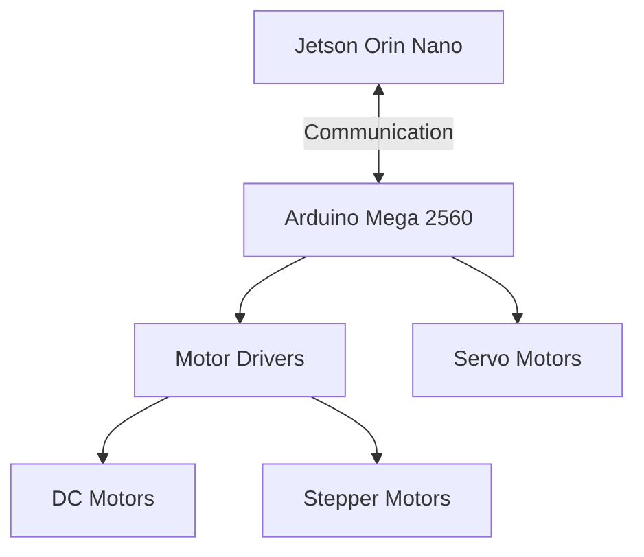
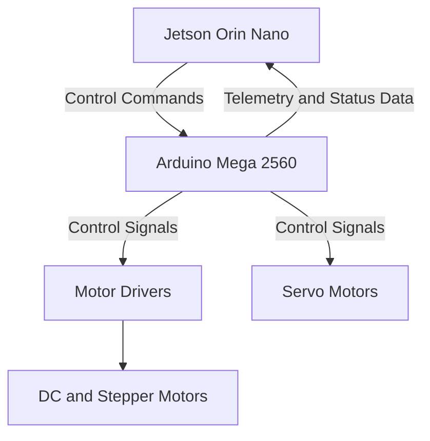

# MAX Robot Hardware

**Hardware architecture, electronics, and integration documentation for the MAX open-source robotics platform.**

MAX is an open-source educational robotics platform developed by **Mensch Robotics Private Limited**. This repository documents the physical hardware system behind MAX, providing a technical reference for understanding its architecture, electronic components, connections, and hardware design.

The repository is intended for students, educators, researchers, robotics developers, and open-source contributors interested in exploring, building, customising, and extending the MAX Robot hardware.

---

## Table of Contents

- [Overview](#overview)
- [Hardware Architecture](#hardware-architecture)
- [Hardware Components](#hardware-components)
- [Motor Control System](#motor-control-system)
- [Communication Architecture](#communication-architecture)
- [Power Distribution](#power-distribution)
- [Hardware Connections and Wiring](#hardware-connections-and-wiring)
- [Hardware Documentation](#hardware-documentation)
- [Customisation and Expansion](#customisation-and-expansion)
- [Contributing](#contributing)
- [License](#license)
- [About MAX](#about-max)

---

## Overview

The MAX Robot hardware platform integrates computing systems, microcontrollers, motor drivers, actuators, power electronics, and supporting components to enable robotic operations.

Its architecture separates high-level computing from low-level hardware control, allowing individual subsystems to be understood, maintained, and extended independently.

This repository serves as a central reference for the physical and electronic aspects of the MAX Robot.

## Hardware Architecture

The MAX Robot hardware architecture is organised around two primary computing units:

| Computing Unit | Responsibility |
|---|---|
| Jetson Orin Nano | High-level computing and processing |
| Arduino Mega 2560 | Low-level hardware control and actuator interfacing |

The Jetson Orin Nano handles high-level operations, while the Arduino Mega 2560 manages the control signals required by the connected hardware components.

### System Architecture

This modular structure separates computing, control, and actuation functions within the robot.

## Hardware Components

The MAX Robot consists of several hardware categories that work together to support its functionality.

| Category | Description |
|---|---|
| Computing Hardware | Main computing and processing unit |
| Microcontroller | Hardware control and interfacing |
| Motor Drivers | Electronic motor control interfaces |
| DC Motors | Motorised movement |
| Stepper Motors | Controlled mechanical movement |
| Servo Motors | Position-based actuation |
| Power Electronics | Power supply, regulation, and distribution |
| Supporting Electronics | Wiring, connectors, and interface components |

Detailed component specifications, functions, and technical information will be maintained in the hardware documentation.

## Motor Control System

MAX integrates different motor and actuator types to support its mechanical movements.

The motor control system includes:

- DC motor control
- Stepper motor control
- Servo motor control
- Motor driver integration
- Hardware control interfaces

The Arduino Mega 2560 manages the low-level control signals used to operate the connected motor drivers and actuators.

## Communication Architecture

Communication between the computing units and hardware components enables coordinated robot operation.

### Communication Flow

The communication architecture includes:

- **Jetson to Arduino:** Transfers commands for hardware operations.
- **Arduino to Jetson:** Transfers telemetry and status information.
- **Arduino to Motor Drivers:** Sends control signals for motor operation.
- **Arduino to Servo Motors:** Provides signals for servo control.

Detailed communication protocols, interfaces, connection configurations, and command formats will be documented separately.

## Power Distribution

The MAX Robot includes a power distribution system that supplies the computing units, control electronics, motor drivers, and other hardware components.

The power system documentation covers:

- Battery and power input
- Power distribution architecture
- Voltage regulation
- Electrical connections
- Power protection

Refer to the relevant hardware documentation before modifying power connections or electrical components.

## Hardware Connections and Wiring

This section covers the physical integration of the MAX Robot's hardware components.

Documentation will include:

- Component connection details
- Controller and driver interfaces
- Motor connections
- Wiring diagrams
- Electrical connection references

These resources are intended to help developers understand how the different hardware subsystems are interconnected.

## Hardware Documentation

Detailed technical information will be organised into dedicated documentation files to keep the main README easy to navigate.

| Documentation | Description |
|---|---|
| Hardware Architecture | Overall hardware design and system layout |
| Component Specifications | Hardware component details and specifications |
| Electronic Components | Electronic modules and their functions |
| Hardware Connections | Component interfaces and connections |
| Wiring Diagrams | Electrical wiring and connection diagrams |
| Motor Control | Motor drivers and actuator control |
| Communication | Communication interfaces and data flow |
| Power Distribution | Power supply and regulation system |
| Hardware Design | Physical hardware design information |

Detailed documentation will be added progressively as the project develops.

## Customisation and Expansion

MAX is designed to encourage learning, experimentation, and further development in robotics.

The modular hardware architecture provides opportunities to explore:

- Integration of additional sensors and actuators
- Alternative motor configurations
- Extended electronic interfaces
- Additional hardware modules
- Compatible computing platforms
- Custom hardware modifications

Contributors are encouraged to explore improvements while maintaining compatibility with the existing hardware architecture.

## Contributing

Contributions from the robotics and open-source community are welcome.

You can contribute by:

- Improving hardware documentation
- Adding component specifications
- Providing wiring diagrams and connection references
- Suggesting hardware improvements
- Documenting compatible components
- Sharing custom hardware extensions

### Contribution Guidelines

1. Explore the existing repository and documentation.
2. Identify an area for improvement or contribution.
3. Create a separate branch for your changes.
4. Provide clear documentation and relevant diagrams.
5. Submit a pull request for review.

Please ensure that hardware modifications and technical information are properly documented.

## License

Licensing information will be announced once the project license has been finalised and approved by Mensch Robotics.

## About MAX

MAX is an open-source educational robotics platform developed by **Mensch Robotics Private Limited**. It is designed to provide students, educators, and developers with a platform to explore robotics through hardware, electronics, programming, and practical experimentation.

**Developed by:** Mensch Robotics Private Limited

**Website:** https://menschrobotics.com

**Main Ecosystem Repository:** https://github.com/menschrobotics/maxrobot
